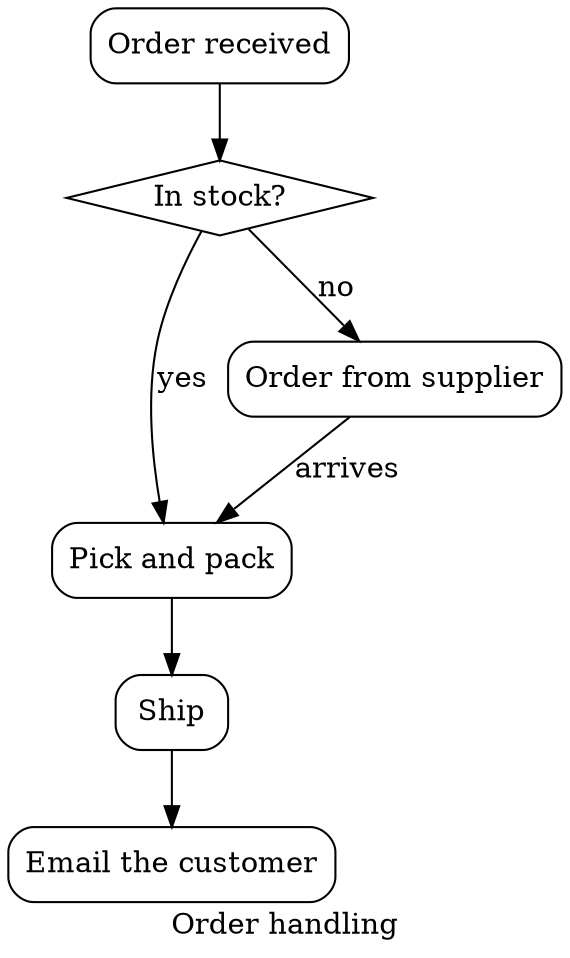
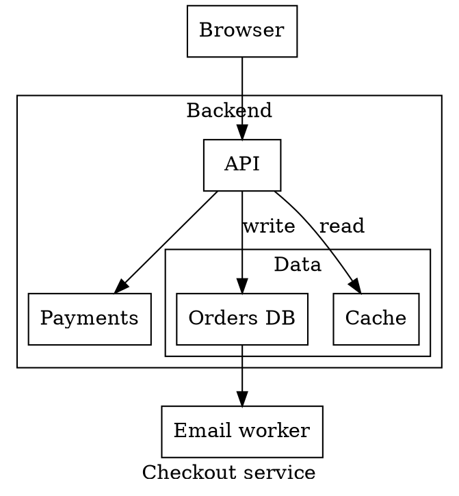

# Graphviz Integration

MAIDR provides an adapter for [Graphviz](https://graphviz.org/) diagrams that turns the SVG Graphviz draws into an accessible, navigable graph with audio sonification, text descriptions and braille output.

The adapter reads the drawing alone. It needs neither the DOT source nor Graphviz in the page, so it works on whatever drew the SVG: the `dot` command, a [Quarto](https://quarto.org/docs/authoring/diagrams.html) `{dot}` cell, R's [DiagrammeR](https://rich-iannone.github.io/DiagrammeR/), or a WebAssembly build such as [`@hpcc-js/wasm-graphviz`](https://www.npmjs.com/package/@hpcc-js/wasm-graphviz) or viz.js running in the page.

## Quick Start

Load `maidr.js` and `graphviz.js`, then call `bindGraphviz()` once the drawings are in the page:

```html
<!doctype html>
<html lang="en">
  <head>
    <meta charset="UTF-8" />
    <title>My Graphviz Diagram</title>
    <script src="https://cdn.jsdelivr.net/npm/maidr/dist/maidr.js"></script>
    <script src="https://cdn.jsdelivr.net/npm/maidr/dist/graphviz.js"></script>
  </head>
  <body>
    <!-- The SVG `dot -Tsvg` wrote, pasted or included as it is -->
    <svg width="222pt" height="465pt" viewBox="0.00 0.00 222.00 465.00">
      <g id="graph0" class="graph">...</g>
    </svg>

    <script>
      maidrGraphviz.bindGraphviz();
    </script>
  </body>
</html>
```

`bindGraphviz()` finds every Graphviz drawing in the document, converts each one and sets its `maidr` attribute, which MAIDR picks up as it does any other chart. Click the diagram, or tab to it, and use the arrow keys.

## How It Works

Graphviz's SVG is regular: the graph is a `<g class="graph">`, each node a `<g class="node">` and each edge a `<g class="edge">`, every one titled with what the DOT source called it. A node's title is its name; an edge's is its two ends joined by `->` (or `--` in an undirected `graph`), each end followed by its port when the edge named one. The adapter reads:

- **nodes**, in drawing order, each announced by the text drawn on it. A node drawn with no text, such as `shape=point`, is announced by its name;
- **edges**, each pointing from the node it leaves to the node it arrives at, with the text drawn on it (its `label`, and any `xlabel`, `headlabel` and `taillabel`) as the edge's label;
- **clusters** (`subgraph cluster_*`), each by its drawn label, or by its name without the `cluster` prefix when it draws none;
- **the graph's `label`**, as the figure's title.

Graphviz draws a cluster's nodes beside the cluster's group, not inside it, so what puts a node in a cluster is the outline drawn around it: the adapter reads each node's position from the drawing's own coordinates and puts it inside every cluster whose outline holds it.

Each node is paired with its own group in the drawing, so the node the reader is on is outlined. Graphviz numbers its groups `node1`, `node2`, ... afresh in every drawing, so the adapter marks each group with `data-maidr-graphviz-node` and gives the SVG an id when it has none: two graphs on one page are kept apart.

## Supported Graph Types

### Stable chart types

None yet. Every graph type below is experimental.

### Experimental chart types

| Graph | MAIDR type | What the reader moves through |
|-------|-----------|-------------------------------|
| Directed Graph [experimental] | `directed_graph` | A `digraph`: nodes in the order the edges run, each announcing the nodes feeding it and fed by it, with the edges' labels. |
| Directed Graph with Clusters [experimental] | `directed_graph` | A `digraph` with `subgraph cluster_*` blocks: each cluster is a scope the reader opens with Down and leaves with Up, nested as the clusters are. |

An undirected `graph` is not read yet: `createMaidrFromGraphviz` throws on one rather than giving its links a direction, and `bindGraphviz` reports it on the console and leaves it as drawn.

## Code Examples

### Stable chart types

None yet.

### Experimental chart types

#### Directed Graph [experimental]

A `digraph` becomes a `directed_graph`. The reader starts on a node nothing feeds and moves along the edges, hearing each node's inputs and outputs with their labels: below, `Pick and pack` is reached from `In stock?` (yes) and from `Order from supplier` (arrives).



```js
// The drawing is already in the page, inside #diagram.
maidrGraphviz.bindGraphviz(document.getElementById('diagram'), { nodeLabel: 'Step' });
```

`nodeLabel` names what a node is on this graph, so MAIDR says "Step" where it would otherwise say "Node".

#### Directed Graph with Clusters [experimental]

Each cluster becomes a scope of the directed graph, named by its label. The reader meets a cluster as one item in the order the edges run, hears how many nodes are inside it, opens it with Down to walk its nodes, and leaves it with Up. Clusters nest as they are drawn: below, `Data` is a scope inside `Backend`.



The node the reader is on is outlined; a cluster is not, since MAIDR derives a scope from its nodes rather than from a drawn element. A cluster announces the label Graphviz drew on it. In DOT a subgraph inherits its parent's `label` unless it sets its own, so a cluster inside a labelled graph draws -- and is announced by -- the graph's label; give it `label=""` to draw none and have it called by its name instead.

## Quarto

Quarto draws a `{dot}` cell with Graphviz when it renders, and writes the SVG straight into an HTML or Reveal.js page. Load the adapter after the body and every diagram on the page is made accessible:

````markdown
---
title: "Release process"
format:
  html:
    include-after-body:
      text: |
        <script src="https://cdn.jsdelivr.net/npm/maidr/dist/maidr.js"></script>
        <script src="https://cdn.jsdelivr.net/npm/maidr/dist/graphviz.js"></script>
        <script>maidrGraphviz.bindGraphviz();</script>
---

```{dot}
digraph {
  label="Release process";
  build -> test -> ship;
  test -> fix [label="fails"];
  fix -> build;
}
```
````

Other formats -- PDF, Word, Typst -- draw the diagram as an image, which the adapter has nothing to read in.

## Drawing in the Page

When Graphviz runs in the page, bind the drawing once it is inserted:

```js
import { Graphviz } from '@hpcc-js/wasm-graphviz';
import { renderGraphviz } from 'maidr/graphviz';

const graphviz = await Graphviz.load();
const container = document.getElementById('diagram');
container.innerHTML = graphviz.dot('digraph { a -> b -> c }');
renderGraphviz(container.querySelector('svg'));
```

`renderGraphviz` converts one drawing and sets its `maidr` attribute; `createMaidrFromGraphviz` converts it and returns the figure without setting anything.

## Configuration Options

Each function takes the same options:

| Option | Default | Meaning |
|--------|---------|---------|
| `id` | the SVG's id | The figure's id. `bindGraphviz` uses it only when it is given a single drawing. |
| `title` | the graph's `label` | The figure's title. The graph's name (`digraph Orders`) is drawn nowhere a sighted reader sees it, so it is never used. |
| `subtitle` | none | The figure's subtitle. |
| `caption` | none | The figure's caption. |
| `nodeLabel` | "Node" | What a node is on this graph, announced as the node noun. |

## Using with npm/Bundlers

```js
import { bindGraphviz, createMaidrFromGraphviz, renderGraphviz } from 'maidr/graphviz';
```

`readGraphviz(svg)` returns what the adapter read -- nodes, edges and label -- for a caller that wants to build its own layer, and `isGraphvizSvg(svg)` says whether Graphviz drew an SVG.

## Keyboard Controls

| Key | Action |
|-----|--------|
| Arrow keys | Move between nodes |
| `T` | Toggle text descriptions |
| `B` | Toggle braille output |
| `S` | Toggle sonification |
| `H` | Open the help menu, which lists every command |

## API Documentation

For the complete TypeScript API reference, see the [API Documentation](api/index.html).
